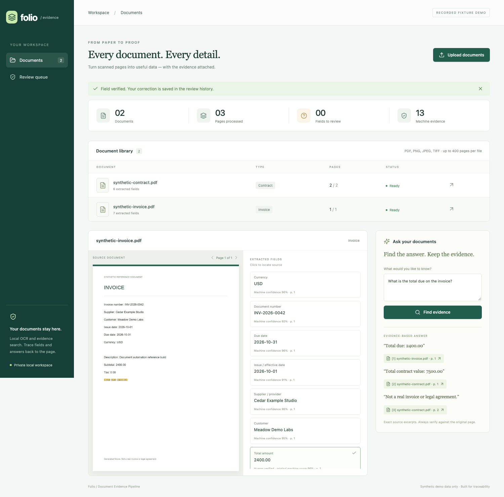
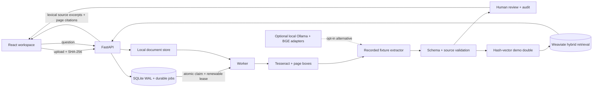

# Folio · Document Evidence Pipeline

### From scanned pages to useful data, with the evidence attached.

Upload an invoice or contract, inspect structured fields beside their source page, correct uncertain
values, and search for exact excerpts with document-and-page citations. This independent MIT reference
shows the practical plumbing around document extraction: OCR, durable jobs, validation, review and retrieval.

**FastAPI · React / TypeScript · Tesseract · SQLite · Weaviate**



*Actual browser capture against the API, worker, Tesseract and Weaviate. The default demo uses manually
authored extraction recordings and deterministic hash vectors. It makes no model or cloud calls.*


## Try it locally

You need Python 3.12–3.13, [uv](https://docs.astral.sh/uv/), Node.js 22+, Docker with Compose v2, and
Tesseract with English language data (`brew install tesseract` on macOS, or
`sudo apt-get install tesseract-ocr` on Ubuntu). Allow about 2 GB RAM for the demo dependencies.
The first setup needs internet access for packages and the Weaviate image; subsequent runs can reuse
them. **No API keys, model downloads, cloud account or paid services are needed.**

```sh
git clone https://github.com/IgorFedchenko/document-evidence-pipeline.git
cd document-evidence-pipeline
./scripts/start.sh
```

Open **http://127.0.0.1:8017**. The server stays in the terminal; Ctrl-C stops it.

1. Upload `fixtures/documents/synthetic-invoice.pdf` and `synthetic-contract.pdf`.
2. Select **Total amount** to highlight its original OCR source words.
3. Edit a value and choose **Verify field**. The original machine score and quote stay visible.
4. Ask **What is the total due on the invoice?** and follow the citation to its page.
5. Upload the same file again to see deduplication; try `needs-review.pdf` for missing fields.

The recorded demo accepts only byte-identical bundled fixtures, including the PNG. This deliberate
scope prevents a different document from receiving a convincing but unrelated recorded response.
All names, dates and amounts are invented. Use synthetic documents only.

SQLite and page images live in `data/recorded/`; search vectors persist in the dedicated
`document-evidence-recorded` Compose volume. Both app and vector ports bind to loopback.

```sh
bash scripts/compose.sh stop          # stop this demo's index; retain its data
# Optional port overrides, useful alongside another local stack:
APP_PORT=8027 VECTOR_PORT=8107 ./scripts/start.sh
```

The helper scripts automatically join `studio-heavy-run` when installed on a shared development host.
An optional workspace token can be set through `ACCESS_TOKEN`; the browser uses an HttpOnly,
SameSite cookie. See [configuration and optional adapters](docs/architecture.md#runtime-modes).

## How it works



The default demo runs real OCR, a real background worker, SQLite persistence and real Weaviate
upserts/hybrid retrieval. Only extraction and embeddings are doubles. API answers use lexical
`evidence_answer`: query terms rank OCR lines and excerpts are returned verbatim. The separate
`OllamaEvidenceSelector` adapter is **not integrated into the API or UI**.

The worker checkpoints OCR pages and two-page extraction batches. Failed work retries with bounded
backoff, then becomes a visible failure with explicit Retry. Content hashes deduplicate uploads;
deterministic index IDs make upserts repeatable. Review uses optimistic versions and an audit trail.

## Integration status

| Status | Components |
| --- | --- |
| Runs locally | FastAPI/worker, React, Tesseract, SQLite and Weaviate. |
| Recorded doubles | Fixture-specific extraction responses and hash-vector embeddings. |
| Optional, unconnected | Ollama extraction, BGE embeddings and standalone model selector; historical local measurement below is separate. |
| Disabled | Cloud Textract/paid OCR. No hosted service or cloud model is connected. |

## What has actually been measured

A historical direct-adapter run at commit `93e347038d2237421e23393ec9abe86115d1be85` used real local
**qwen2.5:1.5b**, Tesseract, BGE embeddings and Weaviate on the two synthetic development PDFs.
**11 of 13 expected fields** had correct values, literal OCR quotes and nonempty source boxes.
Both invoice dates were missing. An extra contract candidate treated a retention duration as a due
date; validation removed its evidence/score and flagged it for review. The original stricter
feasibility gate failed. Extraction behavior is retained as measured.

That small development slice is **not** general accuracy, holdout validation, live API/worker/browser
acceptance or production readiness. The historical standalone model selector returned an exact invoice
citation; the current API uses the lexical path described above. The screenshots and local acceptance
use authored recordings and must not be read as a new live-model measurement.

## Engineering notes

| Boundary | Implementation |
|---|---|
| Structured extraction | Pydantic schema; decimal/date/currency checks; claimed value must occur in a contiguous OCR source span. |
| Review | Missing, conflicting, unsupported or low-score values require attention. Scores are heuristics, not calibrated probabilities. |
| Human corrections | Save the new value and audit event; keep original machine confidence, quote and boxes. Edited values are not automatically re-grounded. |
| Durable work | Atomic SQLite claims, renewable leases, page/batch checkpoints, bounded retries and deterministic index upserts. |
| File safety | Signature/parser checks, 30 MB/file, 400 pages/file, pixel limits, UUID paths and raster previews. |
| Browser safety | Same-origin mutations, trusted-host checks, CSP, React text rendering and no wildcard CORS. |
| Local scope | One workspace; loopback ports; no document text in application logs. No employer/client material. |

Read [architecture](docs/architecture.md), [key decisions](docs/key-decisions.md) and
[testing](docs/testing.md) for the implementation boundaries and reproducible checks.

## Verify locally

After the first start has installed dependencies, stop the app if desired and run:

```sh
./scripts/verify.sh
```

This creates a separate temporary Weaviate project and fresh app data, runs the Python suite with real
OCR and index integration, builds React, and executes Playwright against the real recorded-mode app.
There are no browser API-route mocks. It stops its own processes/containers and removes only its own
temporary vector volume. Reports, video and screenshot go outside the repository by default.
Install Playwright Chromium once if needed: `cd frontend && npx playwright install chromium`.

GitHub Actions is **manual-only and guarded to public repositories**. It remains disabled after publication;
local evidence is the acceptance record. No hosted CI run is claimed.

## Limits

- English printed documents; complex tables, handwriting, multilingual scans and arbitrary document
  layouts need further evaluation. The schema has seven fields, without line items or legal analysis.
- The optional small local model can omit fields and propose invalid candidates. Human review is
  essential. The default recorded demo supports only its bundled synthetic fixture bytes.
- Lexical answers require vocabulary overlap and can return an irrelevant overlapping excerpt.
  Exact source text proves provenance, not that the excerpt answers the question correctly.
- Two-page extraction windows can miss distant relationships. The 400-page input limit is not a
  throughput SLA; CPU OCR/extraction is sequential.
- This local reference has no user roles, deletion/export UI, calibrated confidence or tenant isolation.
  Internet deployment needs authentication/authorization, HTTPS, rate limits, file isolation,
  retention policy, backups and operational monitoring.

Independent work by Igor Fedchenko. Existing contributor/agent attributions are preserved.
Licensed under [MIT](LICENSE).
