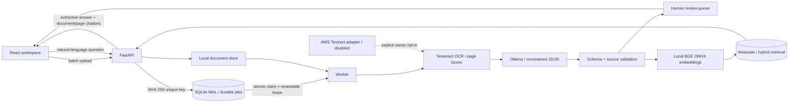

# Document Evidence Pipeline

**Turn scanned invoices and contracts into validated data and searchable evidence.**

A working reference implementation for teams that receive document batches and need structured
records they can actually verify. Upload image-only PDFs or scans, follow processing progress,
inspect extracted fields against highlighted page evidence, review uncertain values, and ask
questions with document-and-page citations.

Python / FastAPI · React / TypeScript · Tesseract · local Ollama · Weaviate · local ONNX embeddings

> Independent MIT reference implementation by Igor Fedchenko. All examples are synthetic.
> No employer/client code, data, names or confidential material is included.


## Run locally

Prerequisites: Docker Engine with Compose, approximately 6 GB available RAM, 6 GB disk, and an
internet connection for the initial image/model downloads. No LLM API key, subscription or cloud
account is needed. CPU inference is intentionally limited to two threads per service.

```sh
git clone https://github.com/IgorFedchenko/document-evidence-pipeline.git
cd document-evidence-pipeline
./scripts/start.sh
```

Open **http://localhost:8016**. Upload `fixtures/documents/synthetic-invoice.pdf` and
`synthetic-contract.pdf` using **Upload documents**. Try **What is the total due on the invoice?**
Select a field to highlight its source words; edit a value and choose **Verify field**. Upload the
same file again to see deduplication. `needs-review.pdf` deliberately omits required fields.

The first start downloads the official Ollama release archive (its SHA-256 is pinned and verified),
retains only CPU libraries in a small runtime image, and downloads the free `qwen2.5:1.5b` model (~1 GB).
GPU/CUDA libraries are excluded. The first indexing request downloads
`BAAI/bge-small-en-v1.5` ONNX weights; later runs use persistent caches. Model inference can take
several minutes on a CPU. The document list shows queued, OCR, extraction, indexing and review states.

```sh
docker compose logs --tail=50 worker   # job ids and error types, never document text
docker compose stop                  # retains local documents, vectors and models
docker compose down                  # removes containers, retains named volumes
```

Optional settings are documented in [`.env.example`](.env.example); copy to `.env` before changing
models or setting `ACCESS_TOKEN`. With a token configured, the UI asks for it once and uses an
HttpOnly, SameSite cookie. Never commit `.env` or credentials. On Studio, `start.sh` automatically
joins the host's shared heavy-job queue.

## Architecture



The API and worker are separate processes. SQLite is the durable queue and system of record;
Weaviate is a rebuildable search index. OCR pages and each two-page extraction batch are committed
independently. Documents become searchable only after indexing completes. The worker processes
one document at a time; uploads remain available while it works.

## Extraction and evidence

- Ollama receives a Pydantic JSON schema, not a request for loosely formatted prose. Invoice and
  contract fields include parties, document number, dates, currency and amount.
- The server validates decimal totals, dates and currency format, checks that the claimed value
  occurs in the supporting quote, and finds a matching contiguous OCR word span on the claimed page.
- Confidence is capped by the weakest supporting OCR word. Missing fields, conflicting values,
  invalid types, unsupported claims and low scores go to human review. Scores are heuristics,
  **not calibrated probabilities**.
- Review uses optimistic versions to prevent lost edits and keeps an audit trail. A human edit
  does not rewrite the original machine confidence or pretend the source said the new value.
- Search combines local dense vectors with Weaviate BM25. Answers are **extractive evidence**,
  not free-form LLM synthesis: every displayed excerpt links to a document and page. The system
  abstains when it cannot find supporting terms. This trades paraphrase coverage for traceability.

## Reliability and security decisions

| Concern | Implementation |
|---|---|
| Duplicate uploads | Content SHA-256 with a database unique constraint; concurrent uploads converge to one document. |
| Worker restart | Atomic claims, renewable leases, page checkpoints and cached extraction batches. Expired final leases become visible failures. |
| Transient failures | Bounded exponential backoff, three attempts, visible error type and explicit Retry. OCR/model results are reused. |
| Index retries | Deterministic object UUIDs and upserts; interrupted indexing can safely repeat. |
| Large batches | Up to 400 pages/file, bounded page rendering and two-page extraction windows; sequential files in the upload batch. |
| Unsafe files | Signature/parser checks, 30 MB file limit, frame/page/pixel limits, UUID storage paths and raster-only preview. |
| Access | Loopback-only published port; vector database and model service have no published ports. Optional workspace token, same-origin mutations and trusted-host checks. |
| Browser safety | React text rendering, CSP, no arbitrary HTML, no embedded original PDF execution, no wildcard CORS. |
| Prompt injection | Document content is untrusted, model has no tools, constrained schema plus independent evidence/type checks. This reduces rather than eliminates extraction errors. |
| Least privilege | API and worker run as a non-root user with dropped capabilities. No AWS credentials are mounted. |
| Data | Local persistent volumes; synthetic fixtures only. No document contents in application logs. Initial model downloads contact their registries. |

This is a **single-workspace local reference**, not a multitenant hosted product. Before internet
deployment add real identity/authorization, HTTPS and secure cookies, ingress request/rate limits,
malware isolation, retention/deletion policy, backup monitoring and a managed job store. The API's
health endpoint is liveness, not an assertion that inference/indexing dependencies are healthy.

## Tests and development

```sh
uv sync --extra dev --python 3.12
npm ci --prefix frontend
uv run ruff check backend scripts tests
uv run pytest -q
npm run build --prefix frontend
# With the local stack running and Playwright browsers installed:
npm run e2e --prefix frontend
```

On Studio wrap builds and E2E in `~/.local/bin/studio-heavy-run -- <command>`, or use
`scripts/verify.sh`. Python tests exercise real Tesseract against image-only gold PDFs, schema and
source validation, paid-service gating, concurrent deduplication, retries, crash recovery,
review conflicts, audit and refusal to invent evidence. Model responses in tests are explicitly
recorded fixtures; no credentials or paid APIs are used.

CI also starts real Weaviate, tests index upserts/hybrid retrieval, builds React, and runs a
browser flow against the real API, OCR, worker and database. Its model/embedding doubles make the
run deterministic and inexpensive. **Green CI is not a measurement of live LLM accuracy.**
The browser flow exercises upload, source highlighting, review, questions, citation navigation,
duplicate upload, abstention and mobile layout. Screenshots, video, trace and test results are
uploaded as private workflow artifacts. See [validation evidence](docs/VALIDATION.md).

To regenerate the synthetic gold documents: `uv run python scripts/generate_fixtures.py`.
For live model evaluation: `PYTHONPATH=backend uv run python scripts/evaluate_live.py` after the
stack is running. It uploads only these synthetic fixtures and reports field accuracy/grounding;
it never calls a paid service.

## Optional Textract adapter

`backend/app/ocr.py` includes the AWS adapter and fake-client tests. It is disabled by default;
setting `OCR_PROVIDER=textract` without `ALLOW_PAID_OCR=true` fails closed. **Do not enable it
until the owner approves cost and installs credentials on the host.** Compose does not forward
AWS credentials. Wire the standard AWS credential chain separately after approval. No cloud LLM
adapter or API-key workflow is included.

## Limits and tradeoffs

- English printed documents; handwriting, rotated/poor-quality scans, complex tables and
  multilingual OCR need additional evaluation/configuration. The sample schema does not extract
  line items, signatures or arbitrary legal obligations.
- A small local LLM can miss fields or generate unsupported candidates. Unsupported candidates
  are visible for review and have zero confidence. Human review remains necessary.
- Two-page extraction windows can miss relationships across distant pages; conflicts require review.
- A 400-page maximum is an input bound, not a throughput SLA. CPU inference is sequential;
  hundreds of pages take time. Review confidence and bulk behavior are tested separately from live accuracy.
- The evidence answer mode requires some query/source vocabulary overlap and is not a general
  conversational assistant. Dense retrieval alone is not proof that a passage answers a question.
- SQLite is appropriate for this small local workload. Horizontal workers, lease fencing and
  production-scale scheduling should move to a dedicated job system.
- Changing the embedding model/dimension requires rebuilding the vector collection. There is
  currently no UI for deletion, user roles, export or reindexing.

License: [MIT](LICENSE). Portfolio copy: [docs/PORTFOLIO.md](docs/PORTFOLIO.md).
